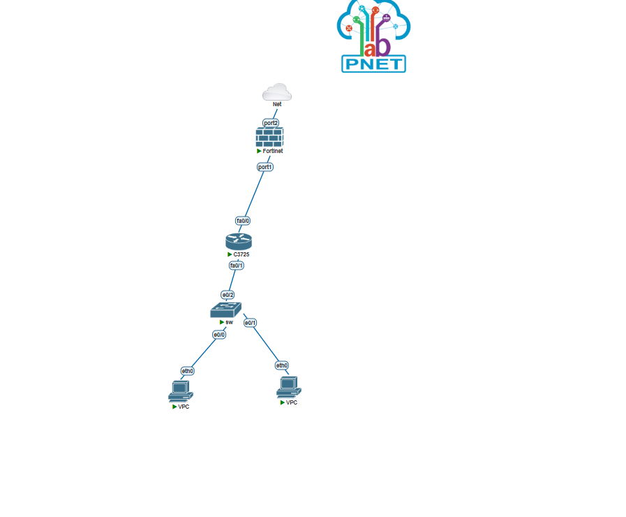

# OSPF + VLAN + DHCP Lab with Cisco C3725 and FortiGate

A PNETLab lab that connects two VLANs to the internet through a Cisco router and a FortiGate firewall. The router and the FortiGate exchange routes with OSPF, the router hands out DHCP addresses, and a switch carries both VLANs to the router over one trunk.


## What the lab does

- Two VPCs sit in different VLANs (10 and 20) on one switch.
- The C3725 routes between the VLANs using router-on-a-stick (sub-interfaces on fa0/1).
- The C3725 runs DHCP for both VLANs.
- The C3725 and the FortiGate form an OSPF neighbor in area 0 over the link between them.
- The FortiGate advertises a default route into OSPF, so the VPCs reach the internet without any static route on the router.
- The FortiGate does NAT toward the internet on port2.

## Addressing

| Network | Subnet | Notes |
|---|---|---|
| Router to FortiGate | 10.0.0.0/30 | C3725 fa0/0 = 10.0.0.1, FortiGate port1 = 10.0.0.2 |
| VLAN 10 | 192.168.10.0/24 | Gateway 192.168.10.1 (fa0/1.10) |
| VLAN 20 (guest) | 192.168.20.0/24 | Gateway 192.168.20.1 (fa0/1.20) |

## Devices

**Switch**
- e0/0 is an access port in VLAN 10 (VPC1).
- e0/1 is an access port in VLAN 20 (VPC2).
- e0/2 is an 802.1Q trunk to the router.

**Cisco C3725**
- Sub-interfaces fa0/1.10 and fa0/1.20 with dot1Q encapsulation.
- DHCP pools `vlan10` and `vlan20`, with the first 20 addresses of each subnet excluded.
- An ACL (`guest-in`) on fa0/1.20 that blocks VLAN 20 from reaching VLAN 10 and allows everything else.
- OSPF process 1, router-id 1.1.1.1, area 0 on all three networks. The two VLAN sub-interfaces are passive.

**FortiGate**
- port1 faces the router (10.0.0.2/30), port2 faces the internet (DHCP).
- OSPF router-id 2.2.2.2, area 0.0.0.0 on 10.0.0.0/30, with `default-information-originate` enabled.
- Firewall policy `lan-internet` from port1 to port2 with NAT enabled.

## Verification

On the router:

```
show ip ospf neighbor
show ip route
```

The neighbor 2.2.2.2 should be FULL, and the routing table should show the default route learned from the FortiGate:

```
O*E2 0.0.0.0/0 [110/10] via 10.0.0.2, FastEthernet0/0
```

On the FortiGate:

```
get router info ospf neighbor
get router info routing-table ospf
```

It should list 192.168.10.0/24 and 192.168.20.0/24 as OSPF routes learned from 10.0.0.1.

From a VPC:

```
ping 8.8.8.8
```

The ping replies once the OSPF neighbor is up.

## Problems I ran into

**1. FortiGate showed no OSPF routes even though the neighbor was FULL.**
The FortiGate still had static routes for 192.168.10.0/24 and 192.168.20.0/24 from an earlier setup. A static route has an administrative distance of 10 and OSPF has 110, so the FortiGate kept the static routes and hid the OSPF ones. Deleting the static routes fixed it, and the O routes showed up right away.

**2. The OSPF neighbor kept dropping.**
The neighbor reached FULL and then went down after about a minute with `Dead timer expired`. While it was down, the router lost its default route and the VPCs got "Destination host unreachable" when pinging 8.8.8.8.

What I checked:
- Area, hello/dead timers, subnet mask and network type matched on both sides (confirmed from the OSPF hello packet on the FortiGate debug).
- `show ip ospf interface` on the router showed hello 10 and dead 40.
- The router sent a hello every 10 seconds, but its debug showed no hello received from 10.0.0.2 while the neighbor was down.
- The FortiGate saw the router as Init, and for a while both sides thought they were the DR.

After turning the debug on and off, the neighbor came up as FULL with a consistent DR and BDR. I did not find a confirmed root cause. Possible causes are the FortiGate VM being slow inside PNETLab or multicast not passing reliably on the virtual link. Next thing to try is `ip ospf network point-to-point` on both ends.

## Files

- `configs/router-c3725.txt`: running config of the router
- `configs/switch.txt`: relevant parts of the switch config and `show vlan brief`
- `configs/fortigate.txt`: interfaces, OSPF, static route and firewall policy
- `topology.png`: lab diagram

## Skills practiced

OSPF on Cisco and FortiGate, router-on-a-stick, 802.1Q trunking, DHCP, ACLs, NAT and firewall policies, and troubleshooting with `show` and debug commands and packet captures.
